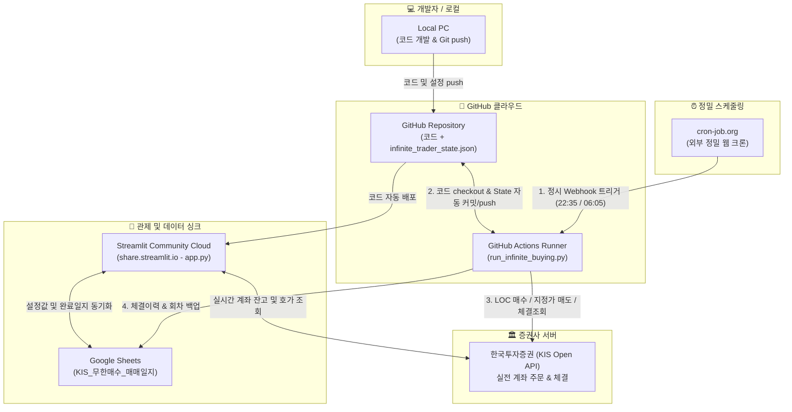
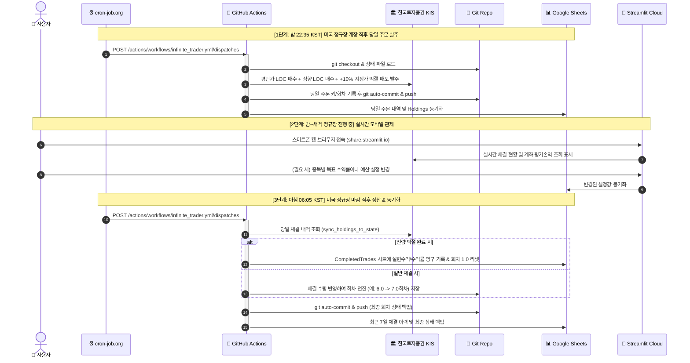

# 🌐 KIS 라오어 무한매수 자동매매 시스템 아키텍처 & 동작 원리

본 문서는 **Local PC, GitHub (Actions & Repo), cron-job.org, Streamlit Cloud (share.streamlit.io), Google Sheets**로 구성된 24시간 365일 무인 자동매매 에코시스템의 세부 역할과 데이터 흐름을 설명합니다.

---

## 1. 시스템 전체 구성도 (High-Level Architecture)

---

## 2. 5대 핵심 구성 요소별 역할 및 책임 (R&R)

| 구성 요소 | 위치 / 인프라 | 주요 역할 및 담당 업무 |
| :--- | :--- | :--- |
| **1. Local PC** | 사용자 개인 컴퓨터 | - 소스코드 개발, 디버깅, 백테스트 및 알고리즘 유지보수 - Git을 통한 GitHub 원격 저장소로 코드 `git push` - 평상시에는 전원을 꺼두어도 전체 시스템 운영에 아무런 영향 없음 |
| **2. cron-job.org** | 무료 외부 웹 크론 서비스 | - **초 단위 정밀 스케줄링 트리거 담당** - **밤 22:35** (장 개장 직후 주문 발주) 및 **아침 06:05** (장 마감 직후 정산)에 GitHub API(`workflow_dispatch`)를 정확한 시간에 호출 - GitHub 내장 cron의 지연(5분~30분 딜레이)을 원천 차단 |
| **3. GitHub (Repo & Actions)** | GitHub 클라우드 | - **중앙 소스 저장소**: 최신 코드 및 상태 파일(`infinite_trader_state.json`, `infinite_settings.json`) 저장 - **무인 실행 엔진 (Actions)**: `run_infinite_buying.py`를 실행하여 증권사로 주문 전송 - **상태 자동 영속화**: 주문/정산 완료 후 변경된 회차를 Git 저장소로 자동 커밋 & 푸시 |
| **4. Streamlit Cloud** | `share.streamlit.io` | - **24시간 웹/모바일 실시간 관제탑 (Dashboard)** - 모바일 브라우저로 실시간 KIS 잔고, 보유 종목, 현재 진행 회차, 평단가 확인 - 종목별 예산, 40분할 회차, 목표 수익률, 40회차 소진 시 옵션 실시간 설정 |
| **5. Google Sheets** | Google Cloud (Drive/Sheets) | - **영구 매매일지 및 데이터 백업 센터** - `CompletedTrades`(익절 완료 일지), `Holdings`(실시간 잔고), `ExecutionHistory`(주문체결 이력) 자동 기록 - 스프레드시트 앱으로 언제 어디서나 엑셀 형태로 자산 추이 열람 가능 |

---

## 3. 일일 운영 프로세스 및 동작 시퀀스

시스템은 하루 동안 다음 3단계 사이클로 전자동 운영됩니다.

---

## 4. 왜 이러한 아키텍처로 설계되었는가? (핵심 설계 의도)

### ① 왜 GitHub Actions 내장 cron 대신 `cron-job.org`를 쓰는가?
GitHub Actions의 `schedule: - cron: '...'`은 전 세계 수많은 프로젝트가 공유하는 무료 리소스이므로, 큐 대기열에 따라 **최소 5분에서 길게는 30분 이상 실행이 지연(delay)**될 수 있습니다.
- 미국 정규장은 현지 시간 09:30에 개장하므로, 개장 직후 안전하게 호가를 확인하고 주문을 넣거나 장 마감 원장 확정 시점에 정확히 체결을 대조해야 합니다.
- **cron-job.org**는 독립된 상시 웹 크론 서버로서, 정해진 시간(**22:35 / 06:05**)에 GitHub API의 `workflow_dispatch` 엔드포인트를 1초의 오차 없이 즉시 호출해주므로 **지연 없는 정시 실행**을 보장합니다.

### ② 삼중 데이터 정합성 (Triple Consistency) 보장
자동매매 시스템에서 가장 위험한 것은 "내가 몇 회차까지 샀는지"를 잃어버리는 것입니다.
1. **1차 저장소 (Git Repo)**: `infinite_trader_state.json` 파일에 커밋되어 형상 관리
2. **2차 저장소 (Google Sheets)**: 클라우드 스프레드시트의 `State` 및 `CompletedTrades` 탭에 실시간 기록
3. **3차 검증 (KIS 증권사 원장)**: 장 마감 후 KIS API를 통해 실제 보유 주식 수량과 평단가를 직접 대조하여 회차를 보정(`sync_holdings_to_state`)

### ③ 서버 비용 0원 & 24시간 무중단 환경
- 로컬 PC를 밤새 켜둘 필요가 없습니다. (전기세, 절전 모드 진입 위험, 인터넷 끊김 위험 배제)
- GitHub Actions (매월 2,000분 무료), Streamlit Cloud (무료 호스팅), Google Sheets API (무료 티어), cron-job.org (무료)를 조합하여 **고정 서버 비용 0원**으로 완벽한 엔터프라이즈급 자동화 환경을 유지합니다.
